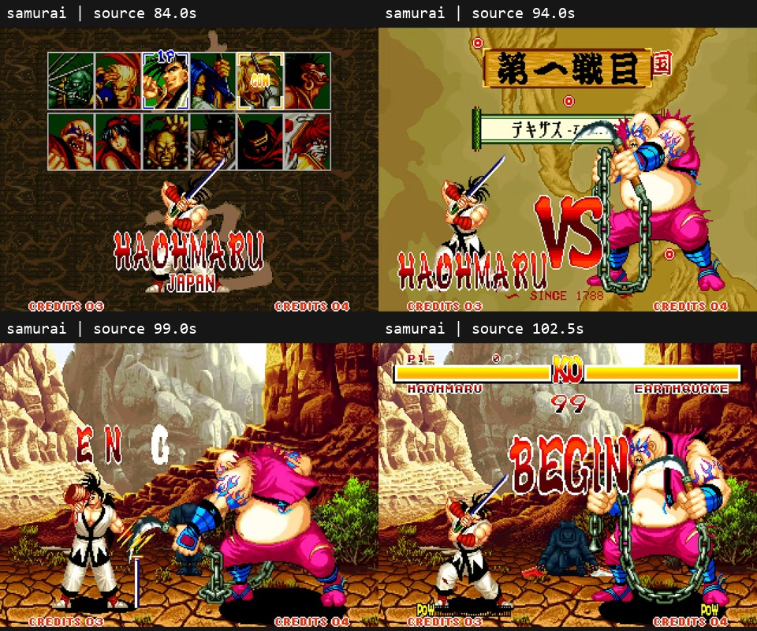
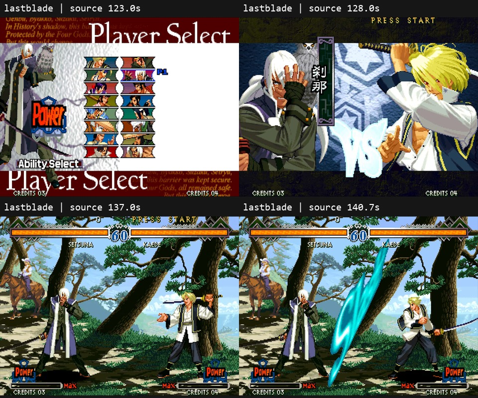
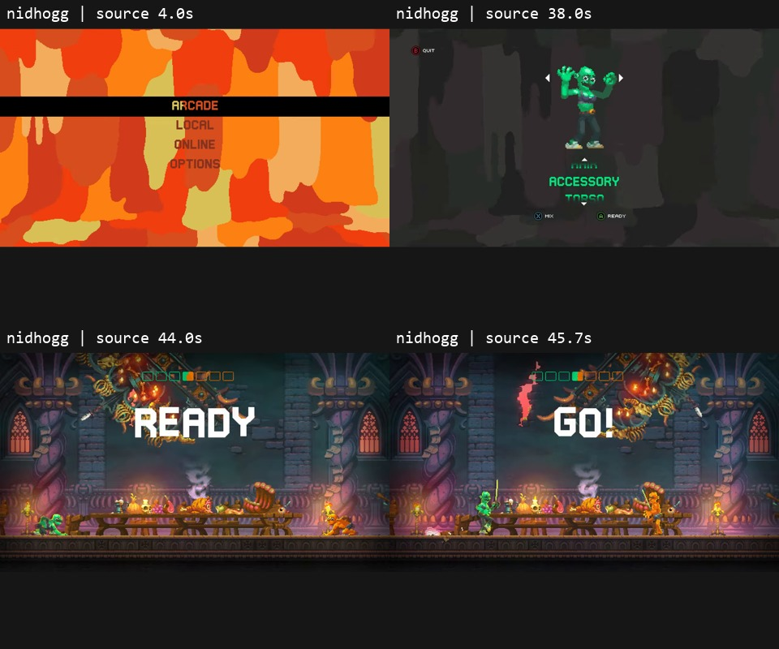

# CLACKBLADE — nghiên cứu menu → trận đấu

Ngày 25/10/2026. Phạm vi: báo cáo tham khảo và đề xuất; chưa sửa gameplay.
Đối chiếu mã nguồn tại `1ea74ffa7d79ed5227f7bc91f3249f53feecd423` trên origin/main.

## Đề xuất chính

Thêm một nhịp dẫn vào trận khoảng **3 giây**:
**Play → chuyển góc nhìn/lộ đấu trường → tên đối thủ và Duel # → READY → TYPE → nhận phím gõ**.
Nhân vật có thể đứng sẵn ở vị trí chiến đấu, nhưng phải được giới thiệu có chủ đích bằng camera,
ánh sáng và tín hiệu bắt đầu. Không cần bắt buộc làm animation đi từ ngoài màn hình vào.
Các thời lượng dưới đây là đề xuất thiết kế cho CLACKBLADE, không phải số đo của game tham khảo.

Lý do: ba mẫu đều phân biệt rõ phần chọn/chuyển cảnh với thời điểm trận bắt đầu.
Điểm thiếu hiện tại là phần dàn dựng và bàn giao quyền điều khiển có tín hiệu rõ ràng;
chỉ thêm một bảng yêu cầu bấm Fight nữa sẽ chưa giải quyết cảm giác vào trận đột ngột.

## Ba mẫu đã xem trực tiếp

Timestamp tính theo video nguồn; các mốc diễn biến được làm tròn. Quan sát chuyển động
không chứng minh chính xác frame nào engine mở input.

| Game / nguồn | Chuỗi quan sát | Điều nên học |
|---|---|---|
| [Samurai Shodown — LongplayArchive](https://www.youtube.com/watch?v=Z7Nglgj4-88&t=83s) | Xác nhận nhân vật khoảng 83,5s → đối thủ/map → VS khoảng 93,6s → lộ sân 96,4s → EN GARDE khoảng 98,4s → DUEL 1 → BEGIN khoảng 102,1s → chuyển động và đòn đánh 103–104s. | Có thứ tự giới thiệu đối thủ, sân và tín hiệu xuất phát; HUD xuất hiện theo nhịp. Không nên bê nguyên độ dài vào game gõ chữ. |
| [The Last Blade 2 — LongplayArchive](https://www.youtube.com/watch?v=H-XhaWrVkVU&t=121s) | Chọn Power/Speed khoảng 122–124s → chân dung/VS → đoạn giới thiệu địa điểm 130,4–135,2s → nhân vật phô diễn tư thế → Stage 1 / Ready → Slash khoảng 140,4s → giao tranh. | Một động tác chuẩn bị riêng của nhân vật tạo cá tính mạnh. Đoạn giới thiệu sân hợp lần đầu hoặc boss hơn là mọi lần retry. |
| [Nidhogg 2 — cub](https://www.youtube.com/watch?v=36UDLPPD_U0&t=39s) | Tùy chỉnh nhân vật → wipe khoảng 39,1s → bản đồ Castle → wipe 43,3s → READY khoảng 43,7s → GO khoảng 45s → hai bên tiến vào giao tranh. | Nhịp mở trận ngắn, đọc được ngay. Hai nhân vật đã ở sân trong READY vẫn tạo cảm giác có mở đầu nhờ chuyển cảnh và cue. |

Định danh game đối chiếu với [SNK: Samurai Shodown](https://samuraianiv.snk-corp.co.jp/english/title/samurai-shodown1/),
[SNK: The Last Blade 2](https://www.snk-corp.co.jp/us/games/acaneogeo/lastblade2/)
và [Messhof: Nidhogg 2](https://store.steampowered.com/app/535520/Nidhogg_2/).
Hai video SNK thể hiện giao diện thuộc họ Neo Geo; video Nidhogg ghi PC.
Không xác minh được revision/build cụ thể, không đồng nhất video Neo Geo với bản Steam.

### Hình đối chiếu

Ảnh trích từ chính video, timestamp ghi trên từng ô. Đây là hình minh họa các trạng thái;
việc xem toàn bộ frame được ghi riêng trong nhật ký bằng chứng.

### Chuyển vòng và giới hạn so sánh

Samurai Shodown, đoạn [128–150s](https://www.youtube.com/watch?v=Z7Nglgj4-88&t=128s):
đòn kết thúc → IPPON khoảng 130,8s → ngã/tư thế thắng → cộng điểm → shutter reset
khoảng 146,9s → DUEL 2 → BEGIN khoảng 148,6s. Không lặp lại chọn nhân vật, map hay VS
trong lần chuyển vòng này. Clip dừng khi BEGIN vừa tan; hành động đầu vòng 2 chưa xác minh.
Chưa xác minh luồng đổi đối thủ, retry, skip hoặc vòng tiếp theo của hai game còn lại.
Không suy rộng một matchup thành hành vi của mọi nhân vật/mode.

## Hai phương án cho CLACKBLADE

### A — mở trận gọn bằng tài nguyên hiện có, khuyến nghị

| Khoảng thời gian sau khi gameplay đã sẵn sàng | Hình ảnh / hành vi đề xuất |
|---|---|
| 0–0,35s | Menu rút đi; chuyển camera về sân bằng chuyển tiếp ngắn, che thời điểm kích hoạt các đối tượng. |
| 0,35–1,25s | Lộ hai nhân vật đối mặt; tên đối thủ và Duel # hiện gọn. Dùng idle hiện có, thay đổi framing/ánh sáng vừa đủ. |
| 1,25–2,15s | Camera về đúng góc chơi; HUD ổn định, READY hiện. Chưa chạy nhịp ra đòn hoặc tính thời gian gõ. |
| 2,15–2,8s | TYPE hiện ngắn; mở từ đầu tiên và combat đồng bộ tại mốc đã chọn. Chữ TYPE rút khỏi vùng đọc. |

Thời gian tải scene không nằm trong ngân sách 2,8s này. Nếu tải lâu, giữ chuyển cảnh ổn định;
không để lộ hai nhân vật hoạt động trong lúc chưa bàn giao xong.
Phương án này có thể làm bằng camera/UI/material và idle hiện có; cần kiểm tra trực quan trong game
trước khi kết luận tài nguyên hiện tại đã đủ. Không đưa hình/video tham khảo vào tài nguyên game.

### B — mở trận có cá tính nhân vật

Giữ cấu trúc A, thêm động tác rút kiếm/giương vũ khí hoặc bước vào vị trí, rồi một phản ứng của đối thủ.
Khoảng 4–5s cho lần đầu gặp boss; trận thường dùng bản rút gọn. Học cách Last Blade 2
cho nhân vật diễn trước cue. Phương án này cần sprite animation riêng và review từng frame/chuyển tiếp;
không thể cam kết chỉ bằng cách dịch chuyển sprite idle.

### Lần đầu, đấu tiếp, chơi lại

- **Play lần đầu:** dùng A đầy đủ; không yêu cầu thêm một lần Enter để bắt đầu sau Play.
- **Đấu tiếp:** giữ kết quả đang có, reset dưới chuyển cảnh ngắn; tên đối thủ/Duel # → TYPE trong khoảng 1,1–1,4s.
- **Retry:** không lặp màn giới thiệu địa điểm; dùng nhịp READY/TYPE ngắn để người chơi kịp đặt tay.
- **Skip:** có thể bỏ phần trình diễn, nhưng vẫn giữ nhịp READY tối thiểu và tiêu thụ phím skip trước khi nhận từ đầu tiên.
- **Pause/thoát trong intro:** khi quay lại phải tiếp tục đúng trạng thái; không mở combat hai lần hoặc để overlay cũ sót lại.

Đây là quy tắc sản phẩm đề xuất, chưa phải hành vi đã xác minh của game tham khảo.
Âm thanh đề xuất: chuyển cảnh nhẹ, một cue bắt đầu rõ; chưa nghe/đánh giá âm thanh nguồn.

## Điểm nối với mã nguồn hiện tại

Mã trên origin/main đã có shared world và session; không dùng giả định từ checkout local cũ.

- [MainMenuUI.cs](../../Assets/Scripts/UI/MainMenuUI.cs), `BeginGame`: gọi `DungeonSession.I.BeginGame`.
- [DungeonSession.cs](../../Assets/Scripts/Rendering/DungeonSession.cs), `ActivateGameplay`: bind shared world,
  đợi nhả Enter, đặt `inputFrame`, kích hoạt gate rồi bật gameplay camera. Đây là đường bàn giao hiện có;
  giữ nguyên cơ chế tiêu thụ phím Play/Continue khi bổ sung intro.
- [DungeonWorld.cs](../../Assets/Scripts/Rendering/DungeonWorld.cs), `ResetView` / `EnableGameplayCamera`:
  sở hữu việc reset framing và CinemachineBrain. Intro nên phối hợp với chủ sở hữu này.
- [EndlessDuel.cs](../../Assets/Scripts/GameController/EndlessDuel.cs), `BeginEncounter`:
  bỏ trạng thái reading và hiện combat ngay; chưa có chuỗi dàn dựng READY/TYPE.
- [GamePauseController.cs](../../Assets/Scripts/GameController/GamePauseController.cs):
  `SetEncounterReading` đi qua freeze, làm dừng score, `AudioListener` và `Time.timeScale`.
  Không dùng nguyên cơ chế đó để khóa intro mà chưa xử lý animation/audio chạy trong thời gian bị khóa.

Khi triển khai, cần một trạng thái intro được kiểm soát trong vòng đời session/encounter hiện có,
giữ quyền điều khiển camera nhất quán; không thêm scene owner hoặc bản sao DungeonWorld.
Khóa input phải đi cùng trì hoãn timer/combat, không chỉ vẽ chữ READY lên combat đang chạy.

Các kiểm tra cần có cho bước triển khai: Play bằng chuột và giữ Enter; gõ trong intro; bỏ qua;
đấu tiếp/retry; pause/quay menu giữa intro; xác nhận HP, timer, score chỉ bắt đầu tại cue;
không chớp actor/HUD/camera lúc kích hoạt gate. Chưa chạy các kiểm tra này vì chưa sửa game.

## Bằng chứng và mức xác minh

Đã áp dụng `$reverse-engineer-anything` và gọi REA để kiểm tra session đang kết nối.
Chưa có artifact của ba game được cung cấp/chọn; session không mở binary.
Ghidra/Java chưa cấu hình khả dụng, IDA thiếu cấu hình MCP, Hopper không hỗ trợ Windows.
Không thực hiện decompile hoặc tạo Evidence ID gameplay từ REA. Kết quả về trình diễn ở đây
là quan sát video công khai, không phải trace runtime hay bằng chứng mã máy.
Vì vậy thời điểm mở input thực sự, nút skip, audio và các nhánh chưa thấy được ghi **chưa xác minh**.

Checklist trước đánh giá: menu/chọn; xác nhận/chuyển cảnh; danh tính đối thủ; dàn dựng/tư thế;
cue bắt đầu; hành động đầu; vòng/đối thủ kế; retry/skip; camera/HUD; audio/input unlock.
Ba đoạn mở đầu có hình và chuyển động cho các trạng thái hiện diện trong từng game;
Nidhogg dùng bản đồ thay vì thẻ VS/tên đối thủ. Vòng kế mới có bằng chứng một phần ở Samurai.
Các mục còn thiếu nêu trên không đạt coverage đầy đủ.

| Đoạn đã khai báo trước review | Frame đã xem / tổng | Chuyển tiếp đã xem / tổng |
|---|---:|---:|
| Samurai 33–105s | 4.320 / 4.320 | 4.319 / 4.319 |
| Last Blade 2 53–144s | 5.460 / 5.460 | 5.459 / 5.459 |
| Nidhogg 2 0–46s | 2.760 / 2.760 | 2.759 / 2.759 |
| Samurai 128–150s | 1.320 / 1.320 | 1.319 / 1.319 |

Tổng 13.860 frame video và 13.856 chuyển tiếp trong bốn đoạn, trên 116 contact sheet tuần tự.
Giữ frame trùng/held và timestamp gốc; mỗi trang sau lặp frame cuối trang trước để xét ranh giới.
Ảnh review rộng 192px/frame, phù hợp phân tích bố cục/trạng thái; không phải kiểm chất lượng sprite.
Đây là frame của bản capture 60fps, không khẳng định tương ứng 1:1 frame mô phỏng game.
Locator lấy mẫu chỉ dùng tìm đoạn, không tính vào coverage. Không tuyên bố đã xem toàn bộ longplay.

Nhật ký quan sát, nguồn, lý do chọn đoạn, số đếm, SHA-256 capture và giới hạn REA:
[evidence.json](duel-entry-evidence/evidence.json).
Capture, frame, sheet, scope ban đầu và công cụ tái tạo giữ ngoài Git tại
`E:/codex-data/artifacts/duel-entry-research-20261025` để audit; có thể xóa sau khi chốt tham khảo
và không còn cần đối chiếu từng frame. Các locator/clip tải thêm chưa review không được dùng làm kết luận.

## Trạng thái bàn giao

Hoàn thành báo cáo so sánh trong phạm vi bằng chứng nêu trên và hai phương án có thể triển khai.
Khuyến nghị chọn A trước, bổ sung B cho boss khi có animation đạt yêu cầu.
Chưa triển khai intro, chưa thay asset hoặc hành vi game; các nhánh thiếu bằng chứng vẫn chưa xác minh.
